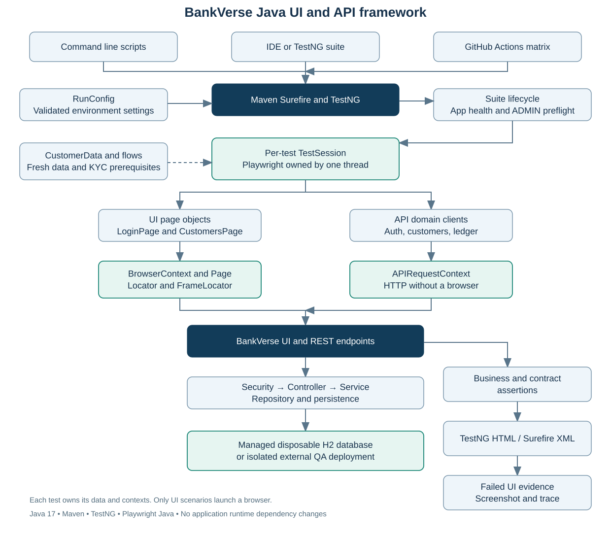
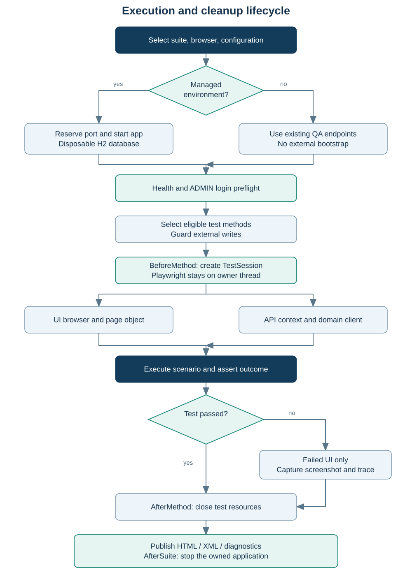

# Framework architecture for the demo

This framework tests BankVerse through the same browser and HTTP boundaries used by clients. Java test code lives in a standalone Maven module named automation-java. Spring Boot application dependencies remain in the parent application's pom.xml.

## Architecture flowchart

The editable Mermaid source is architecture.mmd. The SVG works offline in a browser, Word, or a presentation.

## Responsibilities by layer

| Layer | Files | Responsibility |
| --- | --- | --- |
| Entry points | scripts/run.ps1, scripts/run.sh, pom.xml, testng.xml | Choose suite, browser, headless mode, and parallelism |
| Configuration | config/RunConfig.java | Validate origins, credentials, booleans, timeouts, and managed/external mode |
| Suite lifecycle | core/BaseTest.java, core/ManagedApplication.java | Start a disposable application, wait for health, provision a managed administrator, validate login, stop owned processes |
| Test lifecycle | core/TestSession.java, core/PlaywrightFactory.java | Create thread-owned Playwright instances, lazy browser/API contexts, authentication, failure evidence, and cleanup |
| Write protection | core/WriteGuard.java and BaseTest before-method check | Exclude write methods on existing environments unless explicitly enabled; direct IDE runs also check the write tag |
| API clients | api/AuthClient.java, CustomersClient.java, LedgerClient.java | Express HTTP operations and endpoint paths through APIRequestContext |
| Page objects | pages/LoginPage.java, CustomersPage.java | Express UI actions with test IDs, roles, labels, and response waits |
| Reusable business setup | flows/OnboardingFlow.java | Register customer, complete KYC, activate customer, and open a fresh account |
| Data | data/CustomerData.java | Generate synthetic, per-test customer identities |
| Assertions | assertions/Contracts.java | Check response status, required fields, structured errors, and absence of sensitive fields |
| Tests | tests/api, tests/ui | Describe scenarios and assert business outcomes |
| Evidence | target/surefire-reports, target/artifacts, target/application.log | Provide HTML/XML results, failed UI screenshots/traces, and server diagnostics |

## Why these design decisions matter

Playwright Java is the automation library. TestNG supplies test discovery, lifecycle annotations, data providers, groups, and class-level parallel execution. Maven Surefire supplies command-line test execution, XML integration, and failure exit codes. This is different from the TypeScript Playwright Test runner: there is no playwright.config.ts, built-in project dependency graph, or TypeScript HTML reporter in this Java module.

API tests use Playwright APIRequestContext, so no browser is launched for an API-only run. A driver process is still required by the Java library. UI tests use Browser, BrowserContext, Page, Locator, and web-first assertions. Hybrid scenarios use both interfaces in the same test to check persistence.

Every invocation creates a separate TestSession on the executing TestNG thread. The instance creates and disposes its own Playwright, request contexts, and browser resources. ThreadLocal associates that session with its owner; an explicit thread check catches accidental cross-thread use. Parallelism is configured at class level, with two workers by default. Increase it only after measuring the environment and ensuring all prerequisites remain independent.

The browser is lazy: test().api() authenticates and creates an HTTP context; test().page() launches a browser only when UI automation asks for it. This keeps API runs independent of browser binaries. Browser reuse and session pooling can be added later, but the current preference is clear isolation and predictable teardown.

## Execution flowchart

## Exact lifecycle

1. Maven Surefire discovers TestNG test methods and selects groups.
2. WriteGuard removes write-tagged methods if external mode has not opted into mutation.
3. BaseTest BeforeSuite starts the managed app or uses the configured QA endpoints.
4. ManagedApplication verifies that the local port is available, starts Maven in the parent application folder, and polls health for up to 180 seconds.
5. A suite-local Playwright/API context checks health, checks bootstrap status, creates an administrator only for a new managed database, and verifies an ADMIN login. It closes before parallel test execution starts.
6. BeforeMethod creates the invocation's TestSession on that test's thread. A second write check protects direct IDE execution.
7. The test asks for anonymous API, authenticated API, a blank UI page, or a signed-in UI page.
8. Clients/page objects perform actions; contracts and test assertions verify results.
9. AfterMethod captures screenshot and trace for failed UI tests, then closes contexts, browser, driver, and clears ThreadLocal state.
10. AfterSuite stops only the application process tree created by this suite. A JVM shutdown hook is a fallback when the run is interrupted.

Setup failures fail the Maven build. Test failures fail the build. Teardown errors fail the build. Evidence capture is best effort and does not replace the original test failure. There are no automatic test retries or hidden request retries.

## Data and authentication flow

A fresh customer payload uses a UUID email, random valid PAN, phone, and Aadhaar-like synthetic identifiers. It is created per scenario or data-provider invocation. The framework avoids shared customer numbers and shared account balances.

The application stores employee login data in sessionStorage. The signed-in helper authenticates through API, opens the UI origin, seeds sessionStorage once, and reloads the UI. It does not continually reinject credentials on navigation, so logout can remain effective. Dedicated login tests exercise the real login form. A new BrowserContext starts without authentication; a separate context test verifies that boundary.

Authenticated API contexts attach a per-test X-Correlation-ID. It is available in TestSession.correlationId and failure report output. This ID identifies API-context calls, not all UI requests; the current frontend generates or receives its own correlation values.

## Environment boundary

Managed mode uses H2 with PostgreSQL compatibility, generated test-only JWT signing configuration, isolated port 18080, and the existing test schema for customer/account sequences. External mode uses the configured deployed application's persistence and secrets. The framework never bootstraps an external environment.

H2 acceptance tests do not establish PostgreSQL parity, production scalability, full security assurance, or concurrency correctness for financial operations. A release gate should also run against an isolated PostgreSQL QA deployment. The framework can target that deployment through START_APP=false.

## CI flow

GitHub Actions checks out the repository, configures JDK 17 and Maven caching, installs matching browser dependencies, then runs one job per browser. Chromium executes API plus UI coverage; Firefox and WebKit run UI coverage. Each job owns its own disposable application and H2 database. Reports and evidence are uploaded with seven-day retention.

The earlier TypeScript directory is retained as reference. This Java module is the primary documented entry point and CI target.

## Official design references

- [Playwright Java API testing](https://playwright.dev/java/docs/api-testing)
- [Playwright Java threading model](https://playwright.dev/java/docs/multithreading)
- [Playwright Java test runners](https://playwright.dev/java/docs/test-runners)
- [Playwright Java tracing](https://playwright.dev/java/docs/trace-viewer)
- [Playwright Java browser installation](https://playwright.dev/java/docs/browsers)
